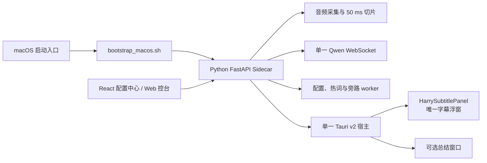

# HARRY Translate V2 Mac

HARRY Translate V2 Mac 是面向 Apple Silicon Mac 的本地实时同传桌面应用。
它使用 Python FastAPI 管理音频、同传会话、配置和旁路任务，使用 Tauri v2
承载唯一 macOS 原生字幕浮窗，并使用 React 提供字幕界面和五栏配置中心。

当前正式版为 **v2.0-mac-ready**，支持 macOS 13 及以上、Apple Silicon
（arm64）设备。项目采用“单窗口、单主会话、单活跃上游 WebSocket”的稳定
优先架构，核心工程行为可以在没有云端密钥的情况下通过 Mock 和本地测试
验证。

## 当前状态

- 源码、锁文件、构建脚本、测试和本地部署文档均已纳入仓库。
- 正式版标签为 `v2.0-mac-ready`，本地出厂产物为 arm64 `.dmg`。
- 字幕浮窗可在 QuickTime、Safari 视频、Keynote、PowerPoint 等 macOS
  原生全屏 Space 上显示。
- 总结功能默认关闭；总结窗口是可关闭的普通 Tauri 窗口，不承诺显示在
  其他应用的全屏 Space 上。
- MD/SRT/JSON 的后台记录器、原子保存和格式化基础已保留，但**用户侧
  下载/打开仍未开放**，不计入当前已交付功能。
- 本地 `.dmg` 使用 ad-hoc 构建，尚未完成 Apple Developer 签名和
  notarization。

## 功能范围

### 实时同传主链

- 16 kHz、800 样本、1600 字节、50 ms 音频切片。
- 有界发送队列，队列满时丢弃最旧帧，不阻塞麦克风采集。
- 单主字幕窗口和单一活跃上游 Qwen WebSocket。
- Qwen 3.8 安全握手、PING/PONG 健康检查、断线退避和 250 ms 收尾。
- 快速切语时发送 `session.finish`、发布 `session_reset` 并过滤旧语种残句。
- 物理麦克风使用温和 AGC；系统回环音频直通，不重复增益。

### 字幕与原生窗口

- 原文、译文和双语三种显示模式，原/译字号与主次视觉可独立配置。
- 唯一原生字幕浮窗内部零按钮、零链接，保持纯黑背景和可拖动缩放。
- 全屏字幕浮窗使用真实非激活 `NSPanel`，不抢键盘焦点。
- 沉浸或锁定穿透后，通过 `harry-tray` 菜单栏或浏览器配置页恢复。
- 动态分区滚动、换行高度补偿和 1000 张历史卡片硬上限。

### 词库、纠错与总结

- 250 条精选词，默认 4096 B、硬上限 6144 B 的 UTF-8 热词预算。
- `asr_fixes`、`terms_trans`、`target_fixes` 三表隔离和区间锁 AC。
- `QuickTermBar` 支持会话临时词注入和单条原子升格。
- 静默纠错默认策略受控，使用 `source_hash` 乐观锁，不阻塞字幕主链。
- 隐藏式重点总结默认关闭，使用有界异步队列和纯规则降级。
- 全程零 Token、零 `usage`、零费用统计、零字幕标红和零 UI 音效。

## 架构



关键设计边界：

- `MAX_OVERLAY_WINDOWS=1`。
- 单一主会话、单一活跃上游 Qwen WebSocket。
- `qwen3.8*` 不发送顶层 `turn_detection`。
- 禁止 `useSubtitleTail` 的人为憋字路径。
- 无客户端时不推流，不产生空转云端请求。

更完整说明见 [TECHNICAL_ARCHITECTURE.md](./TECHNICAL_ARCHITECTURE.md)。

## 部署前置条件

| 项目 | 要求 |
| :--- | :--- |
| 硬件 | Apple Silicon Mac |
| 系统 | macOS 13 或更高 |
| Python | 3.12.x，推荐使用 `uv` |
| Node.js | 24.x，npm 11.x；或满足 `frontend/package.json` 的 engines 范围 |
| Rust | 由 `rust-toolchain.toml` 固定的工具链 |
| 原生构建 | Xcode Command Line Tools 与 macOS SDK |
| 音频 | 麦克风；系统声音模式另需 BlackHole 2ch 等回环输入设备和多输出设备 |
| 云端翻译 | 可选，需要使用者自行准备 DashScope/Qwen API Key |

检查环境：

```bash
uname -m
sw_vers -productVersion
uv --version
node --version
npm --version
rustc --version
```

`uname -m` 应为 `arm64`，Python 应为 3.12.x。

## 基础配置

仓库只提供安全的 `.env.example`，真实 `.env` 必须由使用者在本地创建，
且不得提交到 Git。

```bash
cp .env.example .env
chmod 600 .env
```

基础配置项：

| 变量 | 必填 | 用途 |
| :--- | :--- | :--- |
| `DASHSCOPE_API_KEY` | 真实云端连接时必填 | 阿里云百炼 API Key；示例文件只含占位值 |
| `QWEN_REALTIME_WS_URL` | 否 | 留空时使用公开 DashScope 默认端点 |
| `WORKSPACE_ID` | 私有 MaaS 时按需 | 由使用者在本机填写，不得提交实例专用主机名 |
| `SAMPLE_RATE` | 否 | V2 默认 `16000` |
| `CHUNK_SIZE` | 否 | V2 默认 `800` 样本，即 50 ms |

业务配置：

- `config/user_settings.json` 是本地用户配置，已被 Git 忽略。
- `config/glossary.json` 保存用户自定义词。
- `config/provider_catalog.json` 保存可公开的 provider 能力目录。
- `glossary_bank/00_base_emergency.json` 与
  `glossary_bank/01_curated_everyday.json` 是随仓库分发的 250 条精选词库。

没有 API Key 时，前端、Mock smoke、Rust 构建、原生窗口生命周期和本地
HTTP/WS 仍可验证；真实云端翻译结论必须由使用者用自己的 Key 单独完成。

## 需从仓库获取的文件

| 文件或目录 | 用途 |
| :--- | :--- |
| `启动同传系统.command` | Web 控台和浏览器浮窗入口 |
| `启动桌面悬浮窗.command` | Tauri 原生字幕浮窗入口 |
| `切换API_Key.command` | 本地密钥更新入口 |
| `.env.example` | 安全配置模板；不包含真实密钥 |
| `pyproject.toml`、`uv.lock`、`requirements.lock` | Python 3.12 依赖与可复现锁定 |
| `frontend/package.json`、`frontend/package-lock.json`、`frontend/.nvmrc` | 前端依赖和 Node 版本 |
| `rust-toolchain.toml`、`src-tauri/Cargo.toml`、`src-tauri/Cargo.lock` | Rust 工具链与 Tauri 依赖 |
| `config/provider_catalog.json` | Qwen 模型、语言和路由能力目录 |
| `config/glossary.json` | 可迁移的用户自定义词初始文件 |
| `glossary_bank/` | 运行时精选词库 |
| `src-tauri/icons/`、`src-tauri/Info.plist`、`src-tauri/Entitlements.plist` | macOS 应用元数据与权限边界 |
| `src-tauri/capabilities/` | Tauri 最小权限配置 |
| `scripts/` | 自举、构建、打包、回滚、压测和看门狗脚本 |
| `tests/` | Python、前端原生集成、Mock 和 smoke 测试 |
| `legacy/v1/` | 显式应急回退；不是 V2 自动验收主链 |

`frontend/dist/`、`frontend/node_modules/`、`.venv-v2/`、`src-tauri/target/`
和 `src-tauri/gen/` 是可重建的本地构建产物，不需要从仓库获取。

## 快速开始

只准备环境、不启动服务：

```bash
HARRY_BOOTSTRAP_PREPARE_ONLY=1 ./启动同传系统.command
```

启动原生桌面浮窗：

```bash
./启动桌面悬浮窗.command
```

默认会打开独立浏览器配置页。如不希望自动打开：

```bash
./启动桌面悬浮窗.command --no-open-settings
```

仅启动 Web 控台与浏览器模式：

```bash
./启动同传系统.command
```

实际端口会写入 `.agents/runtime_port`，也可查看终端输出。

```bash
PORT_VALUE="$(cat .agents/runtime_port)"
open "http://127.0.0.1:${PORT_VALUE}/settings"
```

常用页面：

| 页面 | 用途 |
| :--- | :--- |
| `/` | Web 单窗同传工作台 |
| `/en`、`/zh` | 单路兼容大屏 |
| `/split` | 单窗双语监看 |
| `/settings` | 五栏配置中心 |
| `/hud?fallback=browser` | 浏览器浮窗预览和兜底 |

完整安装与构建步骤见 [INSTALL.md](./INSTALL.md)，人工复验见
[TUTORIAL.md](./TUTORIAL.md)，日常操作见 [USER_GUIDE.md](./USER_GUIDE.md)。

## 构建与验证

Python 环境：

```bash
UV_PROJECT_ENVIRONMENT=.venv-v2 uv sync --frozen --python 3.12
```

前端：

```bash
cd frontend
npm ci
npm run typecheck
npm test
npm run build
cd ..
```

Rust：

```bash
cargo test --offline --manifest-path src-tauri/Cargo.toml
cargo build --offline --features custom-protocol --manifest-path src-tauri/Cargo.toml
```

Python 与 Mock：

```bash
.venv-v2/bin/python -m pytest -q tests/
.venv-v2/bin/python -m pytest -q tests/core_regression/
.venv-v2/bin/python scripts/smoke_e2e.py --mock
.venv-v2/bin/python -m pytest -q -s tests/bench/test_soak_benchmark.py
```

静态检查：

```bash
.venv-v2/bin/python -m ruff check app scripts tests switch_key.py
.venv-v2/bin/python -m compileall -q app server.py switch_key.py scripts tests
./tests/check_markdown_links.sh
```

原生生命周期连续验证：

```bash
.venv-v2/bin/python -m pytest -q tests/unit/test_repro_r155s_native_lifecycle.py
for i in 1 2 3 4 5; do
  .venv-v2/bin/python tests/smoke/native_overlay_lifecycle.py
done
```

构建 arm64 `.dmg`：

```bash
./scripts/package-app.sh
```

默认输出：

```text
src-tauri/target/aarch64-apple-darwin/release/bundle/dmg/HARRY Translate_0.2.0_aarch64.dmg
```

当前已验证产物 SHA-256：

```text
eccb5383c4463f771983ba85a4470a6a176ccc4be19e200da2d12a4e14f5b9fd
```

构建产物不入 Git；重新构建后应重新记录哈希。

## 安全与隐私

- `.env`、`.envrc`、密钥、证书、私钥、令牌、用户配置、日志和导出文件
  均由 `.gitignore` 排除。
- 仓库只保留 `.env.example` 占位值，不包含真实 API Key。
- 不从终端、截图、Issue 或提交中公开 API Key、Workspace 实例主机名、
  本机绝对路径和运行 token。
- 前端只显示掩码；`user_settings.json` 拒绝敏感字段。
- API 与业务事件不包含 Token、`usage`、费用或账单字段。
- 提交前应执行 `gitleaks git --redact --no-banner --log-opts=--all .`
  以及 Git 跟踪文件检查。

漏洞报告和敏感信息处理方式见 [SECURITY.md](./SECURITY.md)。

## 仓库关系

- 私人开发备份：
  [xiaokunshi5-lang/harry-translate-v2](https://github.com/xiaokunshi5-lang/harry-translate-v2)
  仅仓库所有者可访问，用于保留开发过程和私人备份。
- 公开正式版：
  [xiaokunshi5-lang/harry-translate-v2-mac](https://github.com/xiaokunshi5-lang/harry-translate-v2-mac)
  只包含干净、可复现的最终源码和正式文档，不作为私人过程材料的镜像。

公开仓库使用独立、干净的历史，避免旧实例专用配置或本地过程记录进入
公开提交。两边的正式源码保持一致，发布改动先进入私人备份，再同步到
公开仓库。

## 文档索引

- [INSTALL.md](./INSTALL.md)：环境准备、从零安装、构建和自动验证。
- [TUTORIAL.md](./TUTORIAL.md)：按功能逐项人工验收。
- [USER_GUIDE.md](./USER_GUIDE.md)：日常启动、配置、浮窗和退出。
- [TECHNICAL_ARCHITECTURE.md](./TECHNICAL_ARCHITECTURE.md)：组件边界、
  生命周期、数据位置和开源依赖。
- [TROUBLESHOOTING.md](./TROUBLESHOOTING.md)：全屏、音频、端口、进程和
  已知限制排查。
- [docs/RELEASE_REPORT_v2.0.md](./docs/RELEASE_REPORT_v2.0.md)：正式发布
  证据、AC 追溯和边界。
- [docs/MAC_EXECUTION_PLAN.md](./docs/MAC_EXECUTION_PLAN.md)：Mac-only
  实施边界和轮次总览。
- [docs/workflows/README.md](./docs/workflows/README.md)：开发与修复工作流。
- [THIRD_PARTY_NOTICES.md](./THIRD_PARTY_NOTICES.md)：第三方来源与许可。
- [CONTRIBUTING.md](./CONTRIBUTING.md)：本地开发、测试和提交要求。

## 已知限制

- MD/SRT/JSON 用户侧下载/打开尚未开放。
- 真实 DashScope 长时断连和真实模型纠错/总结质量需要本机联网复验。
- 真实物理麦克风 AGC 听感、BlackHole 和双音源环境需要本机复验。
- Mission Control、登录界面、屏保和独占游戏不在字幕浮窗全屏承诺内。
- 总结窗口不承诺加入其他应用的全屏 Space。
- `.dmg` 尚未使用 Apple Developer 证书签名或 notarize。

## 许可证

项目自有代码采用 [MIT License](./LICENSE)。第三方组件和复用源码保留各自
许可，详见 [THIRD_PARTY_NOTICES.md](./THIRD_PARTY_NOTICES.md)。
