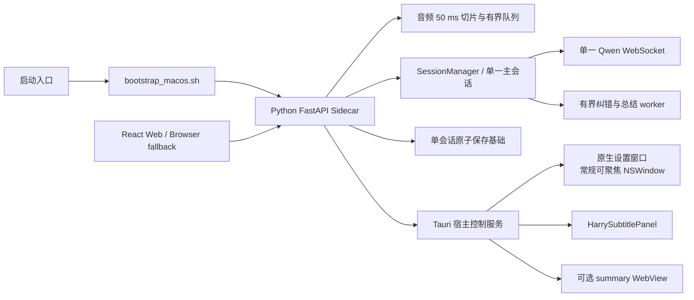

# HARRY Translate V2 Mac 技术架构

## 1. 定位与不变量

HARRY Translate V2 Mac 是 Apple Silicon Mac 上的本地实时同传应用。
Python FastAPI 负责音频、上游会话、配置、词库和旁路 worker；Tauri v2
负责一个原生进程、菜单栏托盘和 macOS 窗口；React 负责 Web 控台、设置页
和原生 WebView 内容。

运行时必须保持：

- `MAX_OVERLAY_WINDOWS=1`；
- 一个主字幕窗口；
- 一个活跃主会话；
- 一条活跃上游 Qwen WebSocket；
- 一个配置业务事实来源；
- 零 Token、`usage`、费用和账单字段；
- 零字幕自动标红、异常徽章和 UI 音效；
- 禁止 `useSubtitleTail`；
- 无客户端时停止推流和上游空转；
- 后端退出后不留下 Tauri 孤儿进程或桌面浮窗。

## 2. 运行拓扑

## 3. 进程与端口

1. 启动器检测本项目已有 Sidecar 或 Tauri 进程，避免重复实例。
2. Python 使用动态端口，并把端口写入 `.agents/runtime_port`。
3. Tauri 通过 stdout 单行 `sidecar_ready` 握手获得端口和实例 identity。
4. Tauri 使用 `tauri-plugin-single-instance` 保证只有一个宿主。
5. Python 向 Tauri 传递 `HARRY_OWNER_PID` 和 `HARRY_INSTANCE_TOKEN`。
6. Tauri 每 500 ms 检查 owner PID 和健康接口，连续失败后正常退出。
7. 本地控制服务只绑定回环地址，提供 show、hide、diagnostics、shutdown。
8. 正常关闭先请求优雅退出，再按项目路径、命令和 PID 精确兜底。
9. 冷启动、Dock/Finder Reopen、应用菜单、托盘和第二实例统一显示原生
   `settings` 窗口，不自动弹出隐藏的 `overlay`。
10. `settings` 关闭时只隐藏；显式“退出应用”才停止翻译、录音、Sidecar
    和 Tauri 宿主。

不使用固定个人路径，不通过宽泛进程名杀进程，不关闭 TLS 校验。

## 4. 音频主链

关键文件：`app/audio/pipeline.py`、`app/audio/backend.py`、
`app/engines/qwen_realtime.py`、`app/session_manager.py`。

- 采样率 16 kHz。
- 每片 800 样本、1600 字节，即 50 ms。
- 音频发送队列有界；满时丢弃最旧帧，避免阻塞采集线程。
- 物理麦克风分支使用温和 AGC。
- 系统/回环分支直通，不重复增益。
- 只有“存在客户端、Key 已配置、引擎 ready、未暂停”同时成立时才推流。
- Qwen 3.8 的 append 与 commit 共用一个有界队列，保证顺序。
- `session.finish` 最多排空 250 ms。
- PING/PONG 为 10 秒检查、4 秒超时；只有连续健康 10 秒才复位退避。
- `qwen3.8*` 不发送顶层 `turn_detection`。

## 5. 单窗与滚动

关键文件：

- `src-tauri/src/windows/overlay.rs`
- `src-tauri/src/windows/native.rs`
- `src-tauri/src/windows/macos_space.rs`
- `src-tauri/src/windows/macos_pointer.rs`
- `frontend/src/windows/overlay/OverlayWindow.tsx`
- `frontend/src/windows/overlay/timeline/`

字幕 overlay 在宿主生命周期内保持唯一，转换为真实非激活
`HarrySubtitlePanel`，使用：

- `NonactivatingPanel`；
- level `1000`；
- `CanJoinAllSpaces`；
- `FullScreenAuxiliary`；
- `CanJoinAllApplications`；
- 显示 `orderFrontRegardless()`，隐藏 `orderOut()`。

Space 变化只对当前可见窗口重放属性，不重新显示用户已隐藏的窗口。

Timeline 使用稳定卡片 ID、`sent_id`、`source_hash` 和 `para_id`。滚动只
补偿换行高度，不延迟文字。历史卡片硬上限为 1000。

## 6. 清洗、纠错与总结

### 清洗

`app/transcript_cleaner.py` 执行填充词、重复、碎片、假句号和段落边界
清洗。段落状态只保留当前有界窗口和单调段落号，不保存整场句子。

### 纠错

`app/bypass/patch_worker.py`：

- 主链只执行 `put_nowait()`；
- 队列有界，满时 Drop-Oldest；
- 定稿卡片使用 `sent_id + source_hash` 乐观锁；
- 旧 generation 不得覆盖新会话；
- 不显示疑点、难度或红字。

### 总结

`app/bypass/summary_worker.py` 和 `src-tauri/src/windows/summary.rs`：

- 默认关闭时零任务、零请求、零 DOM、零窗口；
- 开启后使用有界队列和字数/时间门控；
- 模型失败时降级纯规则；
- 总结窗口是可反复关闭的普通 Tauri NSWindow；
- 不把活动 WebKit 窗口动态转换为瞬态 `NSPanel`，避免 Tao/Foreign
  exception 崩溃；
- 总结窗口不承诺进入其他应用的全屏 Space。

## 7. 配置、词库与持久化

| 数据 | 位置 | 规则 |
| :--- | :--- | :--- |
| 真实密钥 | 本地 `.env` | `0600`，不提交、不打印 |
| 用户设置 | `config/user_settings.json` | UTF-8 JSON，原子写 |
| 自定义词 | `config/glossary.json` | 文件锁、临时文件、`fsync`、`os.replace` |
| provider 能力 | `config/provider_catalog.json` | 可公开、随仓库分发 |
| 精选词库 | `glossary_bank/` | 两包共 250 词 |
| 运行时端口 | `.agents/runtime_port` | 本机可再生 |
| 总结窗口位置 | `.agents/summary_geometry.json` | 本机可再生 |
| 会话保存 | 本地应用数据目录 | 原子 JSON；用户侧导出待开放 |

词库以 `P0 会话词 > P1 用户自定义 > P2 精选包` 排序。默认 corpus
预算 4096 B，硬上限 6144 B。

## 8. 关键代码地图

| 文件或目录 | 全局作用 | 不可破坏的边界 |
| :--- | :--- | :--- |
| `app/main.py` | FastAPI 组合根、路由、生命周期和服务装配 | 不得创建第二上游或绕过单窗门控 |
| `app/session_manager.py` | 会话、客户端门控、事件广播和语种纯度 | 单主会话；关窗停流 |
| `app/engines/qwen_realtime.py` | Qwen 3.8 协议、TLS、队列、健康检查和降级 | 无顶层 `turn_detection`；250 ms 收尾 |
| `app/audio/pipeline.py` | 50 ms 切片、有界队列、RMS 和 AGC 边界 | 不得阻塞采集回调 |
| `app/audio/device_probe.py` | 回环设备探测与结构化降级 | 不得宣称完整 Process Tap |
| `app/glossary/` | 三表隔离、区间锁、预算和原子持久化 | 不得恢复 18k 全量包或标红 |
| `app/transcript_cleaner.py` | 同步清洗与有界段落状态 | 保留清洗语义；不得重新全历史重算 |
| `app/transcript_exporter.py` | 单会话记录、时效保护和格式化基础 | 用户侧下载/打开仍待开放；不得删除 |
| `src-tauri/src/sidecar.rs` | 动态端口、就绪握手、健康检查和退出回收 | 不得留下孤儿进程 |
| `src-tauri/src/windows/native.rs` | NSPanel 转换、层级和主线程调度 | overlay 路径不得被 summary 复用 |
| `src-tauri/src/windows/settings.rs` | 原生设置窗口创建、隐藏和恢复 | 必须是普通 NSWindow；不得连接 `/ws/main` |
| `src-tauri/src/windows/summary.rs` | summary 窗口状态与安全重建 | 禁止动态 NSPanel destroy/close 路径 |
| `src-tauri/src/windows/tray.rs` | 穿透后的菜单栏逃生口 | 不得删除 |
| `src-tauri/capabilities/` | Tauri 最小权限 | 不得扩大或误删 |
| `frontend/src/screens/` | Web 控台和设置页 | 单 `main` 连接；无 usage |
| `frontend/src/windows/overlay/` | 原生字幕画布与 Timeline | 零按钮、零链接、零音效 |
| `legacy/v1/` | 显式应急回退 | 不进入 V2 自动验收；不得删除 |

以下内容可能被误判为“没用到”：

- `app/transcript_exporter.py`；
- `app/bypass/`；
- `legacy/v1/`；
- `src-tauri/capabilities/`；
- `.agents/PROJECT_CONTRACT.md` 与 ADR；
- `src-tauri/binaries/harry-sidecar-aarch64-apple-darwin` 构建锚点；
- GLOSSARY 锁文件和 `.tmp` 原子写流程。

这些是回退、构建、权限、数据完整性或后续导出修复的必要资产。

## 9. 开源与可迁移性

运行和构建依赖来自公开仓库，并由锁文件固定。新增依赖必须满足：

- 可公开获取；
- 可本地部署；
- 许可兼容；
- 不要求私有控制面；
- 不要求仓库内密钥；
- 可在 `THIRD_PARTY_NOTICES.md` 中追溯。

真实 Qwen/DashScope 连接是可选运行时集成。Mock、前端、Rust、本地 HTTP/WS
和原生窗口生命周期不需要私有凭证。

## 10. 测试与门禁

- Python 全量与核心回归；
- Ruff、compileall；
- Vitest、TypeScript、Vite；
- Rust 单测与 custom-protocol 构建；
- Mock smoke；
- 1000 卡片和 2000 句长稳；
- 原生 overlay/summary 生命周期连续 5 次；
- WindowServer 和进程残留检查；
- Markdown 链接检查；
- gitleaks 和 Git 跟踪清单；
- 性能相对可信基线劣化不超过 3%。

不得通过跳过测试、放宽门限、缩小压测规模或伪造 Mock 证据来通过发布。
